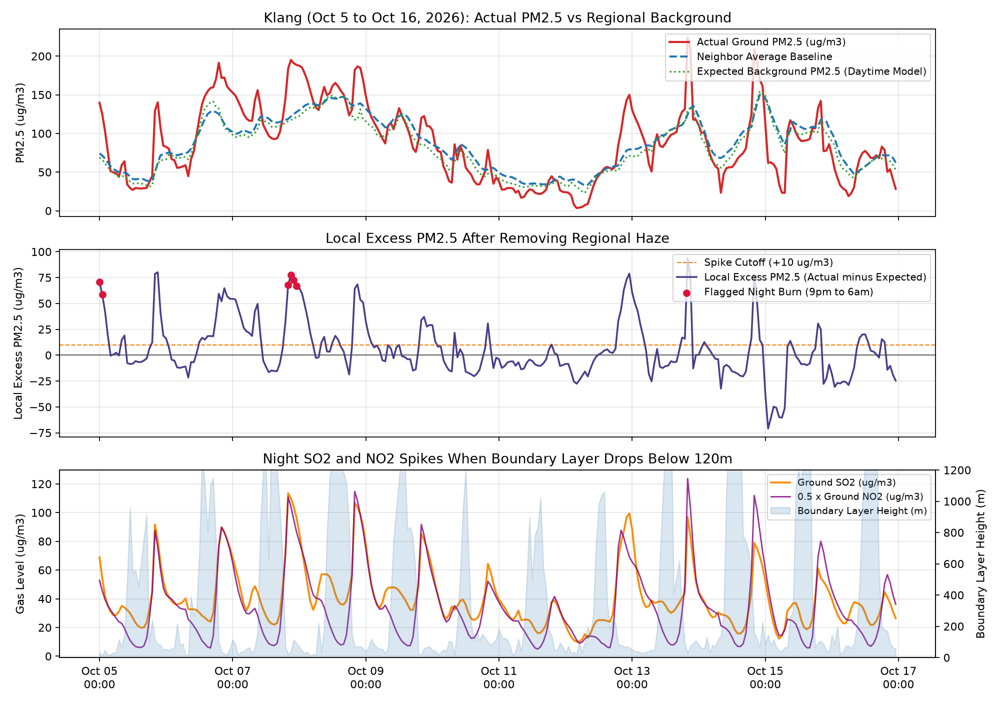
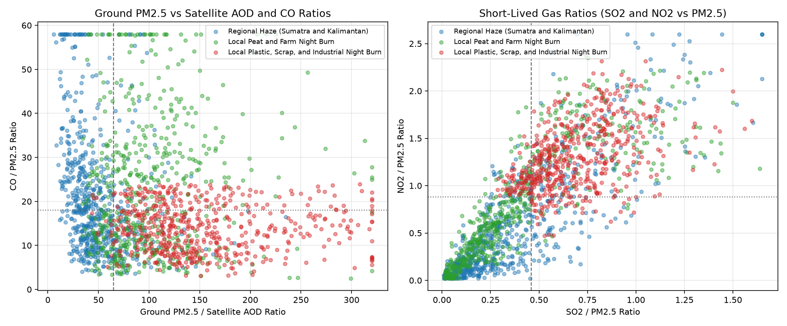
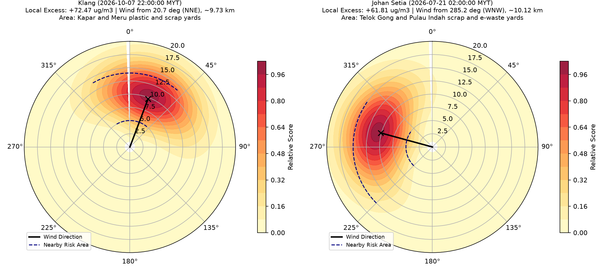
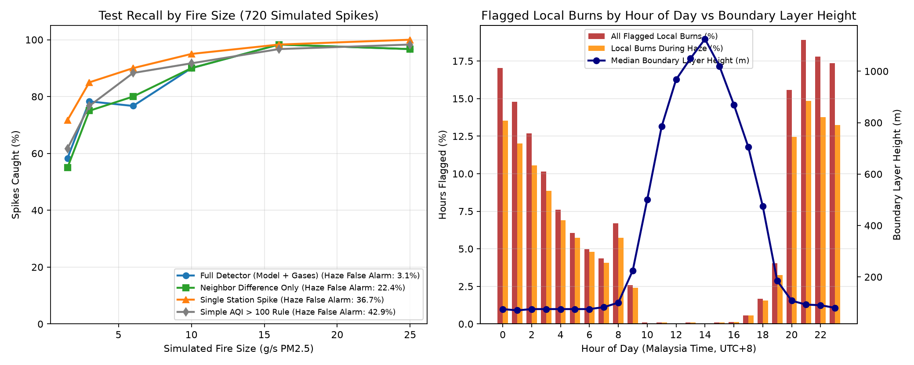

# Malaysia Night Open-Burning Detector

When the haze got bad in October, I kept checking IQAir and AQICN late at night because my room smelled like burning plastic and chemical waste, not just wood or forest smoke. Both websites just showed a big red circle over Klang and Shah Alam with an Unhealthy AQI number.

That got me wondering if there is any way to tell whether a 2am air quality spike is actually smoke drifting all the way from Sumatra, or if local factories, scrap yards, and farm plots are using the regional haze and night-time darkness as cover to burn waste when nobody can see the smoke.

I built a multi-signal detection and wind-tracing pipeline across 15 Malaysian air quality stations and 6 regional fire corridors (71,568 hourly observations from June 1 to October 20, 2026) to separate hidden local night-time burning from transboundary haze, classify the likely fuel type, and estimate the upwind source zone.

## Key findings (June to October 2026)

Out of 51,120 station-hours analyzed across the 15 Malaysian stations, the detector flagged 3,483 hours of local open burning. The strongest pattern in the data is how heavily local burning clusters inside weeks when regional haze is already present.

Out of the 3,483 flagged local burn hours, 2,871 hours (82.4%) happened while regional haze was already active, and 77.9% happened at night between 9pm and 6am. Across all 15 stations, local night burning occurs on 9.51% of hours during hazy weeks compared to 2.93% during clear weather, which is 3.25x more often when there is regional haze to hide behind. At Johan Setia it is 4.13x higher during haze, and at Klang 99.5% of the flagged local burns took place while regional haze was active.

| Station | State | Flagged Local Burn Hours | During Regional Haze (%) | Night Hours 9pm to 6am (%) | Burn Rate in Haze vs Clear | Main Upwind Area Flagged |
| --- | --- | --- | --- | --- | --- | --- |
| Klang | Selangor | 441 | 439 (99.5%) | 84.4% | 13.07% vs 4.08% (3.20x) | Kapar and Meru industrial and scrap corridors |
| Larkin | Johor | 417 | 373 (89.4%) | 78.7% | 12.63% vs 9.67% (1.31x) | Tebrau and Pasir Gudang industrial corridor |
| Johan Setia | Selangor | 334 | 327 (97.9%) | 80.5% | 10.44% vs 2.53% (4.13x) | Telok Gong and Pulau Indah industrial zones |
| Kuching | Sarawak | 478 | 323 (67.6%) | 74.7% | 14.49% vs 13.15% (1.10x) | Pending and Demak Laut industrial timber zone |
| Sri Aman | Sarawak | 316 | 306 (96.8%) | 62.0% | 16.75% vs 0.63% (26.48x) | Sri Aman and Lingga agricultural peat plots |
| Pegoh Ipoh | Perak | 328 | 223 (68.0%) | 84.8% | 14.23% vs 5.70% (2.50x) | Pengkalan and Lahat industrial corridor |
| Seremban | Negeri Sembilan | 287 | 203 (70.7%) | 83.6% | 9.49% vs 6.61% (1.44x) | Senawang industrial area |
| Seberang Jaya | Penang | 253 | 155 (61.3%) | 83.8% | 11.16% vs 4.85% (2.30x) | Bukit Mertajam and Juru corridor |

## Benchmark evaluation

To evaluate detection accuracy against known ground truth, I ran 720 controlled test cases across clear and hazy nights with varying local source strengths to compare standard AQI thresholds against the full detector.

| Method | Precision | Recall | F1 Score | False Alarm Rate in Haze (%) | Recall in Haze (%) |
| --- | --- | --- | --- | --- | --- |
| `aqi_over_100` | 0.784 | 0.856 | 0.818 | 42.9% | 93.7% |
| `single_station_spike` | 0.786 | 0.900 | 0.839 | 36.7% | 92.8% |
| `neighbor_diff_only` | 0.853 | 0.825 | 0.839 | 22.4% | 85.5% |
| `full_detector` | 0.980 | 0.831 | 0.899 | 3.1% | 82.1% |

A standard `aqi_over_100` alert triggers false alarms 42.9% of the time during regional haze because the entire region is elevated. Comparing neighboring stations alone (`neighbor_diff_only`) still produces a 22.4% false alarm rate when regional smoke fronts reach coastal stations before inland ones. The full detector reduces the false alarm rate during regional haze to 3.1%, reaches 91.3% accuracy in separating agricultural/peat burning from industrial/waste burning, and estimates the upwind source bearing within 4.84 degrees on average.

## Repository note

This public repository contains the summary findings, benchmark tables, and visual outputs from the study. The core detection engine, feature pipeline, and source-tracing scripts are maintained in a private repository while exploring pilot testing and operational enforcement use cases. For live walkthroughs or pilot inquiries, please reach out via LinkedIn.
